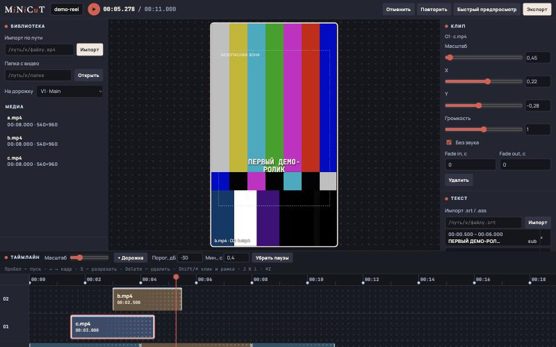

# minicut

**English** · [Русский](README.ru.md)

A small local web video editor for vertical videos (reels, 1080×1920). Cut on a timeline by hand, or let Claude do it for you through MCP: both work on the same project, live.



[](https://github.com/natay1304/minicut/actions/workflows/ci.yml)

## Features
- Main track (ripple) plus up to 10 overlay tracks
- Per-clip scale, position, volume, mute and fades; multi-select, snapping, undo/redo (100 steps)
- Text and subtitles with styles, `.srt` and `.ass` import
- Silence removal, multiple projects
- ffmpeg export with progress, cancel and a fast low-quality preview
- MCP server (stdio): everything the UI does is available to Claude
- Local only: no accounts, no cloud, nothing leaves your machine

## Requirements
- Node.js 20+
- ffmpeg and ffprobe in `PATH` (`brew install ffmpeg` on macOS)

## Quick start
```bash
git clone https://github.com/natay1304/minicut.git
cd minicut
npm install
npm start    # http://127.0.0.1:4317
```
On macOS you can also double-click `scripts/start.command`. Developed and tested on macOS; Linux and Windows should work (Node + ffmpeg) but are untested.

## Use it with Claude (MCP)
```bash
npm run mcp:install                # print the config with your absolute paths
npm run mcp:install -- --code      # register in Claude Code
npm run mcp:install -- --desktop   # add to Claude Desktop / Cowork (backs up your config)
```
Restart the app, then ask Claude: *"Import `/path/to/talk.mp4`, remove the pauses and put it on the main track."* You watch the result live at http://127.0.0.1:4317. The MCP server starts the editor by itself if it isn't running. Tools, examples and troubleshooting: [docs/MCP.md](docs/MCP.md) (Russian); the full tool table is in [docs/API.md](docs/API.md).

## Limitations
- No built-in speech recognition, so no cutting by transcript. Subtitles come from `.srt`/`.ass`, and transcript words can be pushed with `import_transcript`.
- The HTTP API has no authentication. It binds to `127.0.0.1` only; never expose it to a network.
- Homebrew's ffmpeg has no libass/drawtext, so captions are rendered to a PNG track (fonts ship in `public/fonts`).
- The UI targets desktop and mouse. There are no automated UI tests.
- Most documentation under `docs/` is in Russian for now. Translations are welcome.

## Configuration (environment variables)
| Variable | Default | Purpose |
| --- | --- | --- |
| `PORT` | `4317` | server port (binds to `127.0.0.1` only) |
| `MINICUT_DATA` | `./data` | projects, previews and temp files |
| `MINICUT_ROOTS` | home and temp folders | folders you may import from and export to (separate with `:`) |
| `MINICUT_LOG` | `info` | `debug`, `info`, `warn`, `error` |

## Security
Only `127.0.0.1`/`localhost` are accepted: foreign `Host` and `Origin` headers are rejected, `POST` accepts JSON only, import and export are limited to `MINICUT_ROOTS`, hidden folders (`~/.ssh` etc.) are blocked and file extensions are checked. See [SECURITY.md](SECURITY.md).

## Development
```bash
npm test           # node:test, data is isolated in a temp folder
npm run lint       # ESLint
npm run format     # Prettier
```
See [CONTRIBUTING.md](CONTRIBUTING.md) and [docs/ARCHITECTURE.md](docs/ARCHITECTURE.md).

## License
MIT
