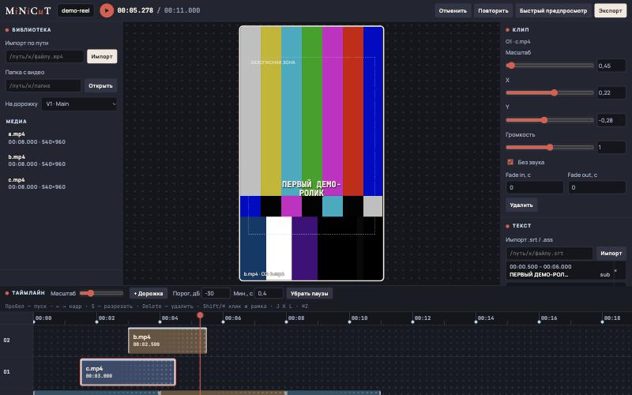

# minicut

[English](README.md) · **Русский**

Локальный веб-редактор для монтажа вертикальных видео (рилсы, 1080×1920). Нарезка на таймлайне руками, а то же самое можно поручить агенту через HTTP API или MCP.



[](https://github.com/natay1304/minicut/actions/workflows/ci.yml)

## Возможности
- Основная дорожка (ripple) и до 10 оверлей-дорожек
- Масштаб, позиция, громкость, mute и fade у каждого клипа; мультивыделение, snap, undo/redo (100 шагов)
- **Кадрирование** (кнопка «Кадрировать» на превью): тяните стороны рамки клипа, двигайте и приближайте картинку внутри неё; пресеты «весь кадр», «верх», «низ»
- **Split-screen**: клип может занимать только часть холста (`region`), так два видео делят один кадр; превью совпадает с экспортом
- Текст и субтитры: стили, импорт `.srt` и `.ass`
- Удаление пауз по тишине, несколько проектов
- Размер панелей (библиотека, свойства, таймлайн) меняется мышью: тяните разделители, двойной клик сбрасывает
- **Локальная расшифровка речи** (whisper.cpp): слова с временем, поиск фраз, поиск повторных дублей, вырезание по тексту, субтитры из расшифровки. Ничего не уходит с компьютера, подробнее в [docs/SPEECH.md](docs/SPEECH.md)
- Экспорт через ffmpeg с прогрессом, отменой и быстрым предпросмотром
- MCP-сервер (stdio): те же операции доступны из Claude

## Требования
- Node.js 20+
- ffmpeg и ffprobe в `PATH` (`brew install ffmpeg`)

## Быстрый старт
```bash
npm install
npm start    # http://127.0.0.1:4317
```
На macOS можно запустить `scripts/start.command` двойным кликом. Проект проверялся на macOS; на Linux и Windows должен работать (Node + ffmpeg), но там его не проверяли.

## Подключение к Claude (MCP)
```bash
npm run mcp:install                # покажет конфиг с твоими путями
npm run mcp:install -- --code      # Claude Code
npm run mcp:install -- --desktop   # Claude Desktop и Cowork
```
MCP сам поднимает редактор, если он не запущен. Подробная инструкция, примеры запросов и разбор проблем: [docs/MCP.md](docs/MCP.md). Список операций: [docs/API.md](docs/API.md).

## Ограничения
- Расшифровка речи требует разовой установки (`npm run setup:speech`, около 570 МБ для модели по умолчанию) и проверена на macOS; установка для Windows автоматизирована, но на реальной машине не проверялась.
- У API нет авторизации. Он слушает только `127.0.0.1`, не открывай его наружу.
- ffmpeg из Homebrew собран без libass и drawtext, поэтому подписи рисуются в PNG-дорожку (шрифты лежат в `public/fonts`).
- Интерфейс пока только для десктопа (мышь, широкий экран), мобильная версия не тестировалась; автотестов на UI нет.

## Настройки (переменные окружения)
| Переменная | По умолчанию | Назначение |
| --- | --- | --- |
| `PORT` | `4317` | порт сервера (слушает только `127.0.0.1`) |
| `MINICUT_DATA` | `./data` | где лежат проекты, превью и временные файлы |
| `MINICUT_ROOTS` | домашняя и временная папки | папки, из которых можно импортировать и в которые можно экспортировать (список через `:`) |
| `MINICUT_LOG` | `info` | уровень логов: `debug`, `info`, `warn`, `error` |

## Безопасность
API доступен только с `127.0.0.1`/`localhost`. Запросы с чужими `Host` и `Origin` отклоняются, `POST` принимает только JSON, импорт и экспорт ограничены `MINICUT_ROOTS`, скрытые папки (`~/.ssh` и т. п.) недоступны, расширения файлов проверяются.

## Разработка
```bash
npm test           # тесты (node:test), данные изолированы во временной папке
npm run lint       # ESLint
npm run format     # Prettier
```
Подробнее: [CONTRIBUTING.md](CONTRIBUTING.md), [docs/ARCHITECTURE.md](docs/ARCHITECTURE.md).

## Лицензия
MIT
